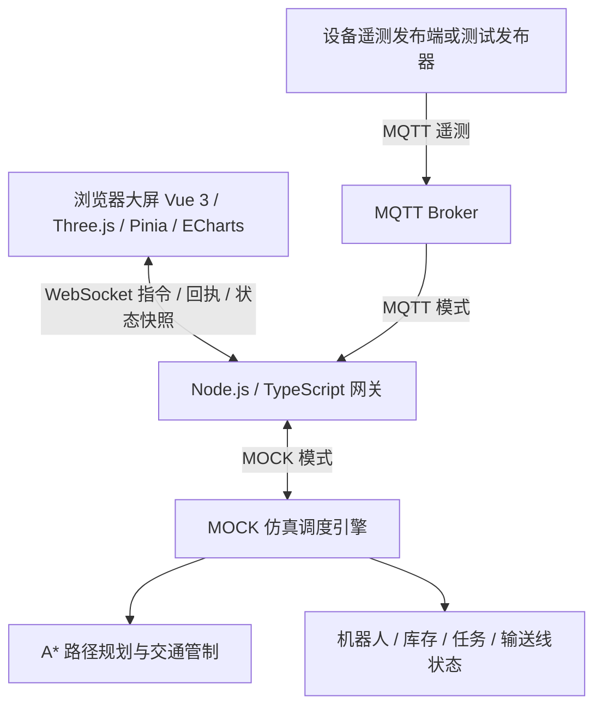

# Industrial Twin

**智能仓储数字孪生与 AGV 仿真调度平台**

基于 Vue 3、Three.js 和 TypeScript 构建的工业仓储 3D 中控系统，配套 Node.js WebSocket/MQTT 网关。通过浏览器派发出库任务，观察双 AGV 完成路径规划、货架取货、输送线卸货和返回待命的完整流程。

当前版本提供可运行的仿真作业闭环，以及 MQTT 遥测接入能力，适合数字孪生演示、仓储流程验证和工业物联网应用开发。实体 AGV 控制仍需开发对应厂商的 RCS 适配器。

## 功能亮点

- **3D 仓储可视化**：展示货架库位、双 AGV、输送线和充电区，支持设备选中、工位视角切换、地面路线和载荷显示。
- **任务执行闭环**：单库位拣选、一键批量出库、库存预留、自动分单、升降取货、配送卸货、归位和补库。
- **路径规划与交通管制**：使用 0.25 m 栅格 A*，考虑货架、输送线、充电柜、防撞立柱及电子围栏；受阻任务等待并重规划，双车中心距至少 1 m。
- **暂停恢复与回充**：暂停保留任务阶段和载荷；车辆先到充电位再增加电量，充满后归位，空闲低电量车辆自动安排回充。
- **后端统一状态**：网关管理机器人、库存、任务和输送线状态，多客户端同步，浏览器断开后仿真继续运行。
- **指令回执与幂等**：唯一请求 ID 防止重复建单，显示接受、拒绝及超时结果，超时不自动重复派单。
- **遥测与回放**：实时设备指标、趋势图、操作日志、历史轨迹回放和 CSV 快照导出。
- **容器化与自动检查**：Docker Compose 部署，GitHub Actions 执行测试、类型检查、构建及依赖审计。

## 系统架构



前端负责展示状态和提交操作意图，仿真引擎负责作业推进、库存变更和任务完成判定。MQTT 模式接收外部遥测，当前拒绝作业控制指令。

### 技术栈

- 前端：Vue 3、TypeScript、Pinia、Three.js、ECharts、GSAP、Vite。
- 网关：Node.js、TypeScript、ws、MQTT.js、tsx。
- 仿真：A* 栅格导航、任务状态机、库存预留、运行时车辆间距检查。
- 验证与部署：Node.js 内置测试运行器、Docker Compose、Nginx、Mosquitto、GitHub Actions。

## 快速开始

### Docker Compose

需要已运行的 Docker Engine / Docker Desktop，并支持 Docker Compose。

1. 在项目根目录复制环境配置：

   ```powershell
   # Windows PowerShell；已有 .env 时请保留现有配置
   Copy-Item .env.example .env
   ```

   macOS / Linux 使用 `cp .env.example .env`。

2. 编辑 `.env`，将 `GATEWAY_TOKEN` 的占位值替换为至少 32 字符的随机令牌。已安装 Node.js 时可用以下命令生成：

   ```sh
   node -e "console.log(require('node:crypto').randomBytes(32).toString('hex'))"
   ```

3. 构建并启动：

   ```sh
   docker compose up -d --build
   ```

4. 打开 [http://localhost:7000](http://localhost:7000)，输入 `.env` 中的令牌。

常用管理命令：

```sh
docker compose ps
docker compose logs -f --tail 50
docker compose down
```

Windows 用户也可运行 `run.bat`，通过菜单启动、停止、重建服务或查看日志。默认前端只绑定本机 `127.0.0.1:7000`，后端与演示 broker 不向宿主机发布端口。

### 本地开发

推荐 Node.js 24，最低 Node.js 20.19；使用 npm 安装锁定依赖：

```sh
npm ci
```

在两个终端分别执行：

```sh
# 终端一：WebSocket 网关
npm run server
```

```sh
# 终端二：Vite 前端
npm run dev
```

打开 [http://localhost:5173](http://localhost:5173)。Vite 将 `/v1/telemetry` 代理到本机 8080 端口。

没有 `.env` 或固定令牌时，MOCK 网关会在终端输出临时访问令牌；已有 `.env` 时使用其中的 `GATEWAY_TOKEN`。网关和模拟 PLC 发布器会读取 `.env`，显式环境变量优先，修改后需重启服务。浏览器令牌仅存于当前标签页的 `sessionStorage`。

## 体验一次完整作业

1. 登录后，点击蓝色占用库位，或在右侧任务中心点击「一键出库」。初始有 6 个有货库位，两台空闲车自动领取任务。
2. 观察车辆沿规划路线到达货架对应列，举升至对应层取货，再驶往输送线卸货。
3. 箱体沿输送线运行，网关统计过箱；车辆返回待命位后任务完成。
4. 作业中可「暂停作业」，再「继续作业」，任务与载荷保持不变。
5. 空闲时可「派发回充」。车辆到桩后才充电，充满后返回待命位；空闲电量低于 20% 时自动安排回充。
6. 所有任务完成后点击「补充库存」，再次执行出库。

电子围栏启用后会触发路线重规划；区域内已有车辆时拒绝启用。目标工位被围栏封住时任务等待，撤销围栏后继续。任务中心显示分配车辆、执行阶段、等待原因及完成记录。

## 环境配置

`.env.example` 提供默认示例，`.env` 已加入 Git 和 Docker 忽略规则。

- `GATEWAY_MODE`：`MOCK` 为仿真，`MQTT` 为外部遥测接入，默认 `MOCK`。
- `GATEWAY_TOKEN`：浏览器访问令牌，Docker Compose 和 MQTT 模式必须配置。不要提交真实值，也不要放入 `VITE_*` 变量。
- `ALLOWED_ORIGINS`：逗号分隔的浏览器来源白名单，包含协议、主机和端口，不支持通配符。示例包含本地 7000、5173 端口。
- `MQTT_BROKER_URL`：broker 地址；本地网关默认 `mqtt://127.0.0.1:1883`，Compose 默认 `mqtt://mqtt-broker:1883`。
- `MQTT_USERNAME`、`MQTT_PASSWORD`：外部 broker 凭据。
- `WS_HOST`、`WS_PORT`：本地网关监听地址与端口，默认 `127.0.0.1:8080`；Compose 内使用 `0.0.0.0:8080`。

如需局域网或公网访问，需调整端口绑定、设置准确的 Origin 白名单并配置 HTTPS/WSS。Compose 自带 broker 仅用于内部演示，无认证且不对宿主开放；外部接入应使用有认证、topic ACL 和 TLS 的 broker。

## 通信协议

### WebSocket

端点：`/v1/telemetry`。连接后先收到 `AUTH_REQUIRED`，客户端发送：

```json
{"type":"AUTH","token":"your-gateway-token"}
```

鉴权后接收 `SYSTEM_INFO` 和遥测；MOCK 模式还发送 `OPERATIONS_STATE`，包含机器人、库存、任务和输送线统一快照。`PING` 返回 `PONG`。

派发拣选任务：

```json
{"type":"COMMAND","data":{"id":"order-001","kind":"PICK","slotId":"LOC-1-1"}}
```

网关用 `COMMAND_RESULT` 返回回执。同一请求 ID 在网关保留的去重缓存内不会重复建单。其他命令：

- `PICK_ALL`：批量出库。
- `CHARGE`、`PAUSE`、`RESUME`：携带 `deviceId`，如 `AGV_01`。
- `SET_GEOFENCE`：携带布尔值 `active`。
- `RESTOCK`：全部作业结束后补库。

仅 MOCK 模式接受上述作业命令，保留旧版 `SET_GEOFENCE` 消息兼容入口。客户端消息最大 8 KiB，每连接每秒最多 20 条，慢客户端发送积压超过 1 MiB 时断开。

### MQTT 遥测

将 `GATEWAY_MODE` 改为 `MQTT`，配置 broker 地址与凭据后重启网关。需要外部发布端持续发送合法遥测；连接 broker 本身不会生成设备数据。

AGV 主题为 `factory/workshop1/agv/01/telemetry` 与 `factory/workshop1/agv/02/telemetry`，ID 分别为 `AGV_01`、`AGV_02`：

```json
{
  "id": "AGV_01",
  "position": { "x": 1.2, "z": -0.6 },
  "heading": 0,
  "battery": 80,
  "speed": 1.1,
  "status": "NAVIGATING",
  "metrics": { "motorTemp": 39, "vibration": 0.6, "mileage": 120, "healthScore": 98 }
}
```

`position`、`heading` 必填，其余遥测字段可选；数值必须有限，坐标绝对值不超过 10000，电量范围 0–100，速度范围 0–100。额外字段会被剥离，不能覆盖本地名称或任务载荷。

库位主题示例：`factory/workshop1/storage/slot/LOC-1-1/status`。

```json
{"id":"LOC-1-1","status":"OCCUPIED"}
```

库位范围 `LOC-1-1` 至 `LOC-3-4`，状态为 `EMPTY`、`OCCUPIED`、`PICKING`，topic 与 payload ID 必须一致。

可在可访问同一 broker 的环境运行 `npm run mock-plc` 测试遥测。Compose broker 默认不对宿主开放，宿主机发布器不能直接连接它的 1883 端口。

前端断线后持续退避重连，最长间隔 30 秒，无消息 15 秒会主动重连。只有两台车均有最近 5 秒内的合法遥测且 broker 在线，才显示在线；断线不会自动切换到合成数据。

## 项目结构

```text
industrial-twin/
├── src/
│   ├── components/          # 大屏、任务中心、设备详情、图表及回放
│   ├── domain/operations.ts # 作业类型、指令校验与适配器契约
│   ├── stores/warehouse.ts  # 业务状态、指令队列、实时与回放隔离
│   ├── three/SceneManager.ts# 三维场景、路线、举升及载荷渲染
│   └── utils/              # 遥测协议、连接管理及输送线工具
├── server/
│   ├── SimulationEngine.ts # 后端仿真作业引擎
│   └── navigation.ts       # 栅格导航与障碍物处理
├── server.ts               # 鉴权、WebSocket、MQTT 与状态广播
├── scripts/                # MQTT 测试发布器及浏览器冒烟验证
├── tests/                  # 自动化测试
├── public/                 # 模型与静态资源
├── .github/workflows/ci.yml
├── .env.example
└── docker-compose.yml
```

## 测试与验证

```sh
npm test
npm run build
npm audit --registry=https://registry.npmjs.org
```

当前包含 20 项自动化测试，覆盖双车连续作业、货架取货与卸货位置、暂停恢复、到桩充电、请求去重、库存预留、围栏阻塞恢复、补库后再次作业、输送线推进与计数、回放隔离、鉴权、重连、跨客户端同步和 MQTT 输入校验。测试无需实体设备，网关测试使用临时端口和测试 broker。

`npm run build` 同时进行前端、网关及 TypeScript 脚本的类型检查。GitHub Actions 在 push 和 pull request 时运行上述检查。

构建容器镜像后，可选运行真实浏览器冒烟验证：

```sh
docker compose build
node scripts/smoke-browser.mjs
```

脚本默认使用 Windows 安装的 Chrome，通过临时容器、随机端口和独立浏览器配置验证页面链路，结束后清理测试资源。可用 `BROWSER_PATH` 指定浏览器、`SMOKE_SCREENSHOT` 指定截图路径，设置 `SMOKE_TASK_FLOW=1` 额外验证拣选和充电完整流程。

## 实现边界

- **设备接入**：MQTT 遥测接入已实现，实体 AGV 控制尚未实现。后续需根据厂商协议实现 RCS 适配器、指令回执与设备状态映射。
- **调度范围**：当前导航与交通规则服务于内置小场景双车仿真，未经工业安全认证；页面暂停与围栏不替代车辆硬件安全回路。
- **状态存储**：任务、库存和载荷保存在后端内存。浏览器刷新或断线后可重新同步，重启后端会重置场景；任务历史与指令去重缓存均有容量上限。
- **历史回放**：来自当前页面实际接收的遥测，约每秒一帧、最多 601 帧。刷新清空浏览器历史；回放期间禁用控制，后端作业继续运行，退出时恢复实时状态。
- **指标来源**：作业数、过箱数、速度、电量及里程来自仿真实际执行；OEE、能耗与碳减排为演示指标。CSV 为内存快照，不是持久化审计记录或完整班次日报。

## 常见问题

**Compose 提示缺少 `GATEWAY_TOKEN`**

确认项目根目录存在 `.env`，并且 `GATEWAY_TOKEN` 已设置为非空随机值。`.env.example` 不会自动作为 Compose 的配置文件。

**登录失败或反复重连**

检查输入令牌是否与网关一致、浏览器实际来源是否在 `ALLOWED_ORIGINS` 中，以及 `docker compose logs backend` 中是否有错误。修改环境配置后，本地开发需重启网关；Compose 需重新执行 `docker compose up -d`。

**MQTT 已连接但设备仍离线**

检查两台 AGV 的主题、ID 和字段是否合法，并持续发布新遥测。broker 连接成功不代表设备在线。

**任务一直等待**

查看任务中心的等待原因，确认是否存在围栏封路或暂停车辆占道，解除阻塞后观察任务继续。

**`npm audit` 在镜像源报错**

部分镜像源未实现安全审计接口，使用 `npm audit --registry=https://registry.npmjs.org`。
